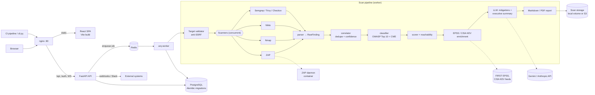

# VulnAuditor

**A defensive web vulnerability auditor. It runs OWASP ZAP, Nmap and Nikto (plus optional SAST, SCA and IaC scanners) against authorized targets, correlates and classifies the findings against OWASP Top 10 and CWE, and uses an LLM to write mitigations and an executive summary.**


> [!WARNING]
> **Use this only on authorized targets.** Scan only systems that you own or that you have explicit written permission to test. Running active scanners against third-party systems without permission is illegal in most jurisdictions. The built-in target validator blocks loopback, private (RFC 1918), link-local and multicast addresses by default (`ALLOW_PRIVATE_SCANNING=false`). It is a safety net, not a substitute for authorization.

---

## Overview

VulnAuditor turns the raw output of several security tools into a single report that has been de-duplicated and prioritized. You give it a target URL. It runs the selected scanners concurrently, normalizes their findings into one schema, merges duplicates across tools (agreement between tools raises confidence), maps each finding to OWASP Top 10 and CWE, and scores severity and priority. It then adds exploit intelligence (FIRST EPSS, CISA KEV) and asks an LLM for remediation guidance and an executive summary.

The project began as a CLI/API MVP. It grew into a multi-tenant platform with a React dashboard, a background job queue, PostgreSQL persistence with Alembic migrations, RBAC, SSO, webhooks, compliance mapping and CI/CD templates.

## Key features

**Scanning**
- **DAST:** OWASP ZAP (via its API), Nmap (`-sV -sC --script=vuln`), and Nikto.
- **SAST / SCA / IaC (optional):** Semgrep, Trivy, `npm audit`, `pip-audit` and Checkov. These run against a shallow clone of a `repo_url` you supply.
- **Built-in passive and light active checks:** a bounded BFS crawler (at most 50 URLs, depth 2, 1 req/s, honours robots.txt), HTTP security-header analysis (CSP, HSTS, CORS, cookie flags and more), client-side JS sink and secret detection, and a lightweight resistance tester that sends no more than 3 requests per endpoint.
- **Graceful degradation:** a missing tool is marked `tool_unavailable` and the scan continues with the rest.

**Analysis**
- **Normalization** of each tool's output into `RawFinding` objects, then **correlation** across tools with de-duplication and a confidence boost.
- **OWASP Top 10 and CWE classification**, plus severity and priority scoring with an API-reachability multiplier.
- **Exploit intelligence:** EPSS probability and CISA KEV membership tags for findings that reference CVEs.
- **LLM-generated mitigations and executive summary.** Gemini is the primary provider and Anthropic Claude is the fallback. Each call has a timeout and retries, and AI is disabled cleanly if no key is configured.
- **Security posture scoring** based on OWASP WSTG controls, with a 5-state verification model, coverage and confidence metrics, and an A–F grade. See [docs/posture-intelligence.md](docs/posture-intelligence.md).
- **Scan diffing** to spot new, resolved and regressed findings, and posture trends over time.
- **Compliance evidence mapping** from CWE to OWASP ASVS 4.0, SOC 2 and PCI DSS 4.0.

**Platform**
- **FastAPI** REST API, versioned under `/api/v1`, with OpenAPI docs, live scan progress over **WebSocket** and SSE, and Markdown and **PDF** reports.
- **Async job queue** with `arq` on Redis and a separate worker container. It falls back to in-process background tasks when Redis is unavailable.
- **Multi-tenancy and RBAC:** organizations and four roles (`owner > admin > analyst > viewer`) with granular permissions.
- **Auth:** JWT access tokens with rotating, hashed refresh tokens; org API keys (`X-API-Key`); optional OIDC SSO (Google, Azure AD/Entra ID, Okta).
- **Signed webhooks** (HMAC-SHA256, with retries), Slack notifications, and an immutable audit log.
- **Rate limiting** with `slowapi`, security-header middleware, and SSRF-safe target validation.
- **CI/CD security gates** for GitHub Actions, GitLab CI, Jenkins and CircleCI (`ci-templates/`), and a CLI with exit codes based on severity thresholds.
- **React 18 + TypeScript dashboard** with targets, scans, findings, reports and settings pages, using TanStack Query, Tailwind and Recharts.

## Architecture



**Docker Compose services:** `nginx` (public port 80), `frontend` (builds the SPA into a shared volume), `api` (FastAPI, runs `alembic upgrade head` on start), `worker` (`arq core.worker.WorkerSettings`), `db` (Postgres 15), `redis` (Redis 7), and `zap` (the ZAP daemon on port 8090). An optional MinIO service for S3-compatible storage is included but commented out.

## Tech stack

| Layer | Technologies |
|-------|--------------|
| API | Python 3.12, FastAPI, Pydantic v2, Uvicorn, slowapi, python-jose (JWT), Authlib (OIDC, optional) |
| Data | SQLAlchemy 2.0 (async), Alembic, PostgreSQL 15 (asyncpg), SQLite (aiosqlite) for local development |
| Jobs | arq on Redis 7 |
| Scanners | OWASP ZAP, Nmap, Nikto, Semgrep, Trivy, npm audit, pip-audit, Checkov |
| AI | Google Gemini (`google-generativeai`), Anthropic (`anthropic`) |
| Reports | Markdown, ReportLab (PDF) |
| Frontend | React 18, TypeScript, Vite, Tailwind CSS, TanStack Query, React Hook Form + Zod, Recharts |
| Infra | Docker, Docker Compose, nginx, optional S3/MinIO, optional Stripe billing |
| Quality | pytest, pytest-asyncio, respx, ruff, mypy |

## Getting started

### Option A: Docker Compose (full stack)

```bash
cp .env.example .env
# Required: set a strong JWT_SECRET
python -c "import secrets; print(secrets.token_hex(32))"
# Recommended: point the scanners at the ZAP container
#   ZAP_API_URL=http://zap:8090
# Optional: GEMINI_API_KEY and/or ANTHROPIC_API_KEY to enable AI mitigations

docker compose up -d --build
```

| URL | What |
|-----|------|
| `http://localhost/` | Web dashboard |
| `http://localhost/api/docs` | Interactive OpenAPI docs |
| `http://localhost/health` | Health check (tool availability, AI, Redis) |

The Compose stack defaults to `REQUIRE_AUTH=true`, so start by registering a user (see [API usage](#api-usage)).

### Option B: Local development

The scanners are optional. Install whichever you want (for example `pacman -S nmap nikto` on Arch), or run ZAP separately and set `ZAP_API_URL`.

```bash
python -m venv .venv
source .venv/bin/activate
pip install -e ".[dev]"            # extras: [sso], [billing], [storage-s3], [all-enterprise]

cp .env.example .env               # defaults: SQLite, REQUIRE_AUTH=false
mkdir -p data
uvicorn api.app:app --reload       # http://localhost:8000/api/docs
```

Optional extras:

```bash
arq core.worker.WorkerSettings     # separate worker (needs Redis at REDIS_URL)
alembic upgrade head               # apply migrations (the API also creates tables on startup)

cd frontend && npm install && npm run dev   # dashboard on http://localhost:3000, proxies to :8000
```

### Option C: Headless CLI (CI pipelines)

```bash
python cli.py --target https://your-authorized-target.example --tools nmap,nikto --mode quick
python cli.py --target https://your-authorized-target.example --format json --output report.json
python cli.py --target https://your-authorized-target.example --threshold high
```

Exit codes: `0` means no findings at or above the threshold, `1` means there are findings at or above the threshold, `2` means the scan failed, and `3` means the arguments were invalid. Ready-made pipeline templates are in [`ci-templates/`](ci-templates/).

## API usage

Stable endpoints live under `/api/v1`. The legacy root-path routes are kept for backward compatibility. If you are running locally without nginx, use `http://localhost:8000` as the base URL.

```bash
# Register (creates an organization) and capture the access token
TOKEN=$(curl -s -X POST http://localhost/auth/register \
  -H "Content-Type: application/json" \
  -d '{"name":"Ana","email":"ana@example.com","password":"change-me-please","org_name":"Acme"}' \
  | python -c 'import sys,json; print(json.load(sys.stdin)["access_token"])')

# Launch a scan (returns 202 with scan_id and poll_url)
curl -X POST http://localhost/api/v1/scan \
  -H "Authorization: Bearer $TOKEN" -H "Content-Type: application/json" \
  -d '{"target_url": "https://your-authorized-target.example",
       "tools": ["nmap", "zap", "nikto"],
       "scan_mode": "full"}'
```

```json
{
  "scan_id": "3f7a1b2c-...",
  "status": "pending",
  "target": "https://your-authorized-target.example",
  "poll_url": "/scan/3f7a1b2c-..."
}
```

| Method and path (under `/api/v1`) | Purpose |
|-------------------------------|---------|
| `GET /scan/{id}` | Poll status and results |
| `WS /scan/{id}/ws` · `GET /scan/{id}/stream` | Live progress (WebSocket / SSE) |
| `GET /report/{id}` · `GET /report/{id}/pdf` | Markdown / PDF report |
| `GET /scan/{id}/diff` | Compare with the previous scan of the same target |
| `GET /findings` · `PATCH /findings/{id}/status` | Triage findings |
| `GET /findings/{id}/remediation` · `/epss` | Remediation template and EPSS score |
| `GET /dashboard` · `GET /posture/trend` | Org dashboard and posture trend |
| `GET/POST /targets` | Manage authorized targets |
| `GET /compliance/{framework}` | ASVS / SOC 2 / PCI DSS evidence report |
| `/users`, `/api-keys`, `/webhooks`, `/audit` | Org administration |

To enable SAST/SCA/IaC, add `"repo_url": "https://github.com/org/repo"` and tools such as `"semgrep"`, `"trivy"`, `"pip_audit"`, `"npm_audit"` or `"checkov"`.

## Configuration

All settings are environment variables. [`.env.example`](.env.example) is the annotated reference. The main ones:

| Variable | Default | Description |
|----------|---------|-------------|
| `JWT_SECRET` | dev value | **Required in production.** Signs JWTs. |
| `REQUIRE_AUTH` | `false` (local) / `true` (Compose) | Enforce authentication. |
| `DATABASE_URL` | SQLite under `data/` | Use `postgresql+asyncpg://...` for multi-worker setups. |
| `REDIS_URL` | `redis://localhost:6379` | arq job queue. |
| `ZAP_API_URL` | — | ZAP daemon API (`http://zap:8090` in Compose). |
| `GEMINI_API_KEY` / `ANTHROPIC_API_KEY` | — | Enable LLM mitigations and summary. AI is skipped if both are empty. |
| `GEMINI_MODEL` / `ANTHROPIC_MODEL` | `gemini-1.5-flash` / `claude-sonnet-4-6` | Model selection. |
| `NMAP_FLAGS` | `-sV -sC --script=vuln -T4` | Nmap arguments. |
| `SCAN_TIMEOUT_SECONDS` | `1800` | Per-tool subprocess timeout. |
| `ALLOW_PRIVATE_SCANNING` | `false` | Allow RFC 1918 / internal targets (lab use only). |
| `STORAGE_BACKEND` | `local` | `local` or `s3` (MinIO compatible). |
| `RATE_LIMIT_*` | see file | Per-route rate limits. |

## Reports and persistence

Scan metadata, findings, targets, users and audit logs are stored in the database. Scan artifacts go to the storage backend:

```
data/scans/{scan_id}/
  scan.json          metadata and status
  normalized.json    correlated findings
  report.md          Markdown report
  raw/               raw tool output (nmap XML, ZAP/Nikto JSON, ...)
```

Example report excerpt:

```markdown
## Findings

### CRITICAL — SQL Injection
| Severity   | critical            |
| Confidence | high                |
| OWASP      | A03:2021-Injection  |
| CWE        | CWE-89              |
| Mitigation | Use parameterized queries ... |
```

## Testing

There are about 290 test cases. They cover the parsers (using recorded ZAP, Nmap and Nikto fixtures), the correlator, scorer, posture scorer, validator, diff rigor, RBAC, auth, billing, the API, WebSockets and the worker.

```bash
pytest -v
pytest tests/test_correlator.py -v
pytest tests/test_scorer.py::test_elevate_to_critical_sql_injection -v

ruff check . && mypy .
```

## Project structure

```
vuln-auditor/
├── api/               FastAPI app, legacy routes, auth, RBAC, /api/v1 routers
├── core/              pipeline: parser, correlator, classifier, scorer, validator,
│                      verification, diff, EPSS/KEV, compliance, worker, storage
├── scanner/           tool runners: zap, nmap, nikto, semgrep, sca (trivy/npm/pip), iac (checkov)
├── ai/                LLM prompts, executive summary, mitigation generator
├── reports/           Markdown and PDF report generators
├── db/                SQLAlchemy models, repositories, audit helpers
├── alembic/           database migrations
├── frontend/          React + TypeScript dashboard (Vite, Tailwind)
├── nginx/             reverse-proxy config
├── ci-templates/      GitHub Actions, GitLab CI, Jenkins, CircleCI security gates
├── tests/             pytest suite + scanner output fixtures
├── docs/              auth, RBAC, webhooks, deployment, posture methodology
├── cli.py             headless scanner for CI
├── Dockerfile         API/worker image (bundles nmap + nikto)
└── docker-compose.yml
```

## Further documentation

- [Deployment guide](docs/deployment.md): production checklist, migrations, scaling, S3, Stripe, SSO
- [Authentication](docs/auth.md) · [RBAC](docs/rbac.md) · [Webhooks](docs/webhooks.md)
- [Posture intelligence methodology](docs/posture-intelligence.md): scoring formulas and verification states
- [Enterprise setup guide (Spanish)](docs/enterprise-guide.es.md)
- [Changelog](CHANGELOG.md)

## License

[MIT](LICENSE) © 2026 Gabriel Huertas
